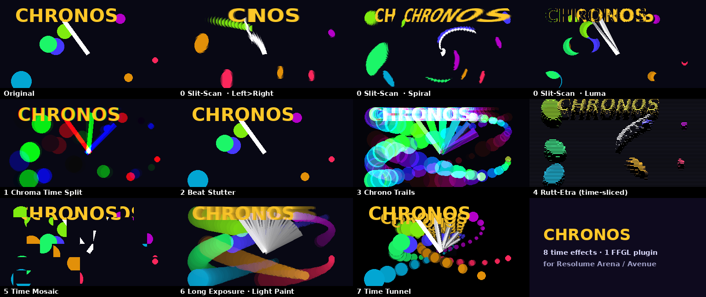

# CHRONOS — 8 time-bending effects in one FFGL plugin for Resolume

People on the Resolume forum have been asking for a native **slit-scan** and **Rutt-Etra** FFGL plugin since 2015.
Right now the only ways to get them are feedback-layer tricks or Wire patches. CHRONOS is a native C++ FFGL 2.x effect
that keeps a **GPU ring buffer of past frames** (one `GL_TEXTURE_2D_ARRAY`), so every mode can read any
moment from the last 16–128 frames directly, with no feedback smearing.



## The 8 modes (choose them in the *Mode* dropdown)

| # | Mode | What it does | Param A | Param B |
|---|------|--------------|---------|---------|
| 0 | **Slit-Scan** | Each pixel shows a different moment in time, set by the *Time Map*: Left>Right, Top>Bottom, Radial, Spiral, Noise or **Luma** (bright areas show older frames). Neighbouring frames are blended, so there's no banding | Map Repeat | Map Speed (scrolls the map) |
| 1 | **Chroma Time Split** | Red is now, green is Depth/2 ago, blue is Depth ago, plus an optional spatial offset | Spread | Angle |
| 2 | **Beat Stutter** | Locks to the BPM. On each *Beat Division* it may loop the last few frames, like a beat-repeat for video | Loop Length | Chance |
| 3 | **Chrono Trails** | Finds motion between past frames and paints it in a colour for each age (rainbow time trails) | Sensitivity | Video Level |
| 4 | **Rutt-Etra** | Classic scanline rasterizer that lifts each line by its brightness. With Depth > 0, **each scanline also comes from a different moment** | Height | Lines |
| 5 | **Time Mosaic** | Blocks of the picture fall behind in time and reshuffle on the beat (datamosh feel) | Block Size | Chance |
| 6 | **Long Exposure** | Camera shutter: from *average* (motion blur) to *max* (light painting) | Light Paint | Decay |
| 7 | **Time Tunnel** | Older frames sink into the distance, and bright parts of newer frames sit in front of them | Zoom | Key Level |

**Shared controls:** Depth (how far back in time to look; the readout shows frames), Reverse Time (flips the direction;
in Time Mosaic it inverts blocks), Beat Division (1/16 … 1 bar), Freeze Buffer (stops recording so you can scrub a
frozen moment), Mix (dry/wet).
**Buffer group:** Buffer Frames (16/32/64/128) and Buffer Res (Full/Half/Quarter).

Small touches: Param A/B **change their names** for each mode (*Map Repeat*, *Loop Length*, *Light Paint*…), controls that
don't apply are hidden, and each mode **remembers its own A/B values**, so switching modes feels like switching
effects. These need Resolume 7.4 or newer; older 7.x versions just show "Param A / Param B".

### VRAM
The buffer uses `width × height × 4 bytes × frames`. At 1080p, Half res with 64 frames is about 130 MB (the default).
Full res with 128 frames is about 1 GB. If allocation fails, the plugin logs a message and you can lower the settings.

## Build

### Easiest: GitHub Actions
Push this folder to a GitHub repo. `.github/workflows/build.yml` builds **Windows x64 `.dll`** and **macOS universal
`.bundle`** and attaches them as artifacts.

### Locally (CMake, fetches the Resolume FFGL SDK automatically)
```
cmake -S . -B build -A x64            # Windows (VS 2019/2022)
cmake --build build --config Release
# macOS
cmake -S . -B build -DCMAKE_BUILD_TYPE=Release && cmake --build build
```

### Inside the official resolume/ffgl repo (Visual Studio)
Copy `source/Chronos` to `<ffgl>/source/plugins/Chronos` and `build/windows/Chronos.vcxproj(.filters)` to
`<ffgl>/build/windows/`. Then in `FFGLPlugins.sln` choose *Add > Existing Project* and build.

## Install
Copy `Chronos.dll` (Windows) or `Chronos.bundle` (macOS) to `Documents/Resolume Arena/Extra Effects`, then restart
Resolume. You'll find it under Effects → **Chronos**.

## Preview without Resolume
`tools/preview_harness.py` runs the exact plugin shaders headless (moderngl + EGL), and `tools/render_showreel.py`
renders `preview/chronos_showreel.mp4`. This is how the modes were tested.
```
pip install moderngl numpy pillow imageio imageio-ffmpeg
python tools/render_showreel.py
```

## Verified so far
- Builds and links against the current resolume/ffgl master and exports `plugMain` (checked on Linux).
- All 8 modes ran on a real OpenGL 4.x driver (Mesa) with the exact plugin GLSL `#version 410 core`.
- Not yet tested inside Resolume itself. Please report anything odd (Resolume's log shows `Chronos:` messages).
